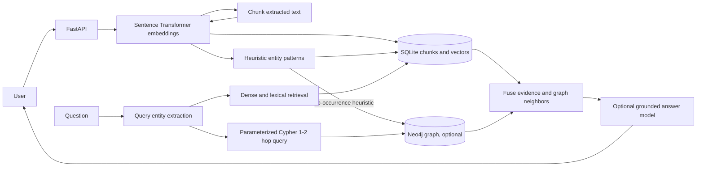

# GraphRAG & Hybrid Knowledge Graph Retrieval System

A hybrid retrieval service for extracting text from PDF/DOCX files, storing sentence-transformer vectors, building an entity co-occurrence graph in SQLite or Neo4j, and combining vector, lexical, and graph-neighbor evidence.

## Workflow

## MVP scope

- Text extraction for PDF and DOCX, with explicit limits.
- Overlapping text chunks stored in local SQLite.
- Entity candidates identified using capitalization patterns.
- Sentence co-occurrence links stored as weak graph-like edges.
- Keyword-overlap retrieval with source snippets.

Embeddings, hybrid ranking, parameterized Neo4j/Cypher graph expansion, and optional grounded answer generation are implemented. When a model endpoint is configured, relation extraction requests schema-shaped facts and validates evidence against source text; otherwise links are marked as co-occurrence heuristics. OCR is not included. Review evidence and generated answers.

## Setup

See [`docs/DEPLOYMENT.md`](docs/DEPLOYMENT.md). Local service defaults to `127.0.0.1:8020` and stores its SQLite index under `data/`.
